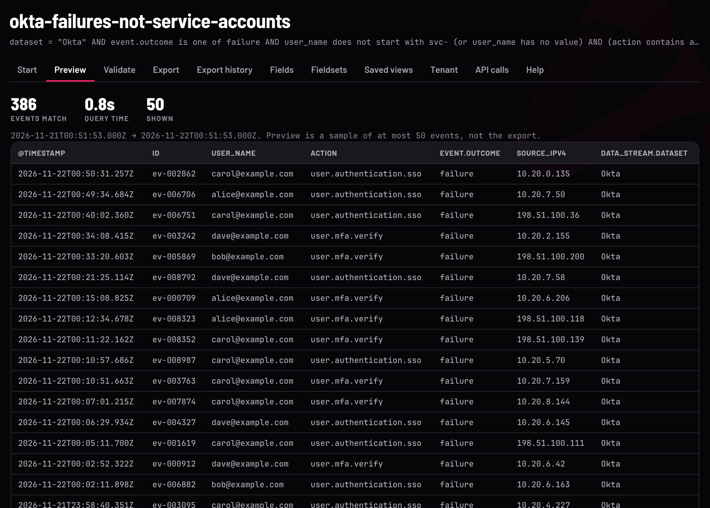

# Abstract Search & Export

Find the events you want in your Abstract Security tenant and export every one of them, with proof that the export is complete. It is a companion to Abstract for jobs that are too large, too repetitive or too scripted for the search screen: long ranges that reach into the archive, exports that run on a schedule, and searches driven by a script or an AI assistant.

It is one engine with four ways in: a browser app, a guided terminal, a command line and an MCP server. It uses Python's standard library and nothing else, so there is nothing to install beyond the tool itself.



## Start it

Pick the one that fits. Every route ends at the same app.

| You have | Do this | Details |
|---|---|---|
| **Docker** | `docker run --rm -p 127.0.0.1:8765:8765 -v "$HOME/AbstractExports:/exports" ghcr.io/iamabs3c/abstract-search-export` and open the link it prints | [Docker](#docker) |
| **Nothing installed** | Download the single file for your system from [Releases](../../releases/latest) and run it | [A single file](#a-single-file) |
| **Python 3.8 or newer** | `python3 search-export/abstract_search.py --web` | [Python](#python) |
| **A browser and a GitHub account** | [](https://codespaces.new/IamABS3C/abstract-search-export?quickstart=1) | [Codespaces and DevPod](docs/codespaces-and-devpod.md) |
| **DevPod** | [](https://devpod.sh/open#https://github.com/IamABS3C/abstract-search-export) | [Codespaces and DevPod](docs/codespaces-and-devpod.md) |
| **Claude Code** | Open this repository in a session: the tool and its MCP server are set up by the repository | [Claude environments](docs/claude-environments.md) |
| **Another AI assistant** | Point it at the MCP server: `python3 search-export/abstract_search.py mcp` or the image with `mcp` | [MCP](search-export/docs/MCP.md) |

## Connect your tenant

You need two things from Abstract: your **vendor account ID** and an **API key**.

1. Start the app by any route above and open the link it prints.
2. In **Connect to your tenant**, enter the vendor account ID and the API key, and choose **Connect**.
3. The app shows the tenant's name. Check it is the one you meant.

The key is held in the app's memory while it runs. It is never written to disk, to a log, to an export or to the browser's storage, and it is never sent back to the page.

For the command line, scheduled jobs and assistants, give the credentials through the environment instead:

| Variable | Value |
|---|---|
| `ABSTRACT_VENDOR_ACCOUNT_ID` | Your vendor account ID. |
| `ABSTRACT_EXPECT_TENANT` | The same ID. Every command refuses to run when the key belongs to another tenant. |
| `ABSTRACT_API_KEY_COMMAND` | A command that prints the key from your secret manager or keychain, for example `op read "op://Security/Abstract API/credential"`. Recommended. |
| `ABSTRACT_API_KEY_FILE` | Or a file that holds the key on one line, where secrets are mounted as files. |
| `ABSTRACT_API_KEY` | Or the key itself, where a scheduler or CI system injects secrets. |

Then check the connection. This reads only, and names the tenant:

```
python3 search-export/abstract_search.py capabilities
```

## Docker

The image holds Python and the tool. It runs as an unprivileged user and downloads nothing when it starts.

```
docker run --rm -p 127.0.0.1:8765:8765 -v "$HOME/AbstractExports:/exports" ghcr.io/iamabs3c/abstract-search-export
```

- Open the link in the output. In Docker Desktop, it is in the container's **Logs** tab.
- Exports are written to `AbstractExports` in your home folder.
- The port is published to this computer only. Keep it that way.

Or let the start script do it. It starts the app in the background, prints the link and opens your browser:

```
curl -fsSLO https://raw.githubusercontent.com/IamABS3C/abstract-search-export/main/search-export/run-docker.sh
sh run-docker.sh            # start        sh run-docker.sh link    a new link
sh run-docker.sh stop       # stop         sh run-docker.sh terminal    the guided terminal
```

On Windows, in PowerShell:

```
irm https://raw.githubusercontent.com/IamABS3C/abstract-search-export/main/search-export/run-docker.ps1 -OutFile run-docker.ps1
powershell -ExecutionPolicy Bypass -File .\run-docker.ps1
```

From a checkout of this repository, `./run.sh` (or `.\run.ps1`) builds the image from the source here instead of pulling it.

The same image runs single commands and the MCP server:

```
docker run --rm -e ABSTRACT_VENDOR_ACCOUNT_ID -e ABSTRACT_EXPECT_TENANT -e ABSTRACT_API_KEY \
  -v "$HOME/AbstractExports:/exports" ghcr.io/iamabs3c/abstract-search-export export --dataset "Okta" --last 24h --merge
```

Compose, another port, secret files, scheduled exports and how the container is locked down: [Run it in Docker](search-export/docs/DOCKER.md).

| Image | Where |
|---|---|
| `ghcr.io/iamabs3c/abstract-search-export` | GitHub's container registry. Tags: the version (`0.5.0`), the minor line (`0.5`) and `latest`. Intel and Arm. |

## A single file

Each [release](../../releases/latest) carries one file per system. It needs no Python and no Docker.

| System | File |
|---|---|
| Windows (Intel) | `abstract-search-<version>-windows-x64.exe` |
| macOS (Apple silicon) | `abstract-search-<version>-macos-arm64` |
| Linux (Intel) | `abstract-search-<version>-linux-x64` |
| Linux (Arm) | `abstract-search-<version>-linux-arm64` |

Run it with no arguments for the guided terminal, or with `--web` for the browser app. Checking the download, the first-run prompts on macOS and Windows, and building it yourself: [The single-file program](docs/binaries.md).

## Python

Python 3.8 or newer, on macOS, Linux or Windows. Nothing to install.

```
git clone https://github.com/IamABS3C/abstract-search-export.git
cd abstract-search-export
python3 search-export/abstract_search.py --web      # the browser app
python3 search-export/abstract_search.py            # the guided terminal
python3 search-export/abstract_search.py --help     # the command line
```

On Windows, use `py` in place of `python3`.

## What it does

- **Search any way you think.** Build a search with filters and every operator Abstract offers, write KQL, describe it in plain English and let Abstract's assistant write the query, or start from a saved view. Every search is checked against your tenant before it runs.
- **Export everything, and prove it.** Recent data and the archive, in slices that resume where they stopped. The export is reconciled against the platform's own count, and the result says complete, partial or incomplete in plain words.
- **Change saved views and fieldsets, safely.** Build a fieldset from the fields a dataset really fills, save a search as a view, or keep both as files and copy them between tenants. Every change is shown for review first and logged.
- **Run on a schedule.** The tool writes a ready job for cron, launchd, systemd, Windows Task Scheduler, GitHub Actions or a container platform.
- **Work from an assistant.** The MCP server gives an AI assistant the same steps, read-only unless you allow changes.

The full guide, with every screen: [search-export/README.md](search-export/README.md). In the app, choose **Help**.

## Security in one page

- The key is held in memory only and sent only to the Abstract API, over HTTPS. The tool never follows a redirect.
- The browser app listens on this computer only, needs a one-time link to sign in, and loads nothing from the internet.
- The only things it changes in a tenant are saved views and fieldsets, each after a review you confirm.
- Exports are real data. They stay in your exports folder until you delete them.
- Release files and images carry a build record you can check: `gh attestation verify <file> --repo IamABS3C/abstract-search-export`.

Everything it calls, stores and sends: [Security](search-export/docs/SECURITY.md).

## In this repository

| Path | What it is |
|---|---|
| `search-export/` | The tool: the program, its tests, its docs and the container build. |
| `run.sh`, `run.ps1` | Start it in Docker from a checkout. |
| `.devcontainer/` | The dev container for Codespaces, DevPod and VS Code. |
| `.mcp.json`, `.vscode/mcp.json` | The MCP server, set up for Claude Code and for VS Code. |
| `.claude/`, `CLAUDE.md` | What a Claude Code session needs to use the tool well. |
| `deploy/claude-self-hosted/` | A runner image for a self-hosted Claude environment. |
| `scripts/` | The session and welcome scripts, and the single-file build. |
| `.github/workflows/` | Tests on every push; images, files and a release on every version tag. |

Tests need no network and no key: `cd search-export/tests && python3 -m unittest discover -q`.
